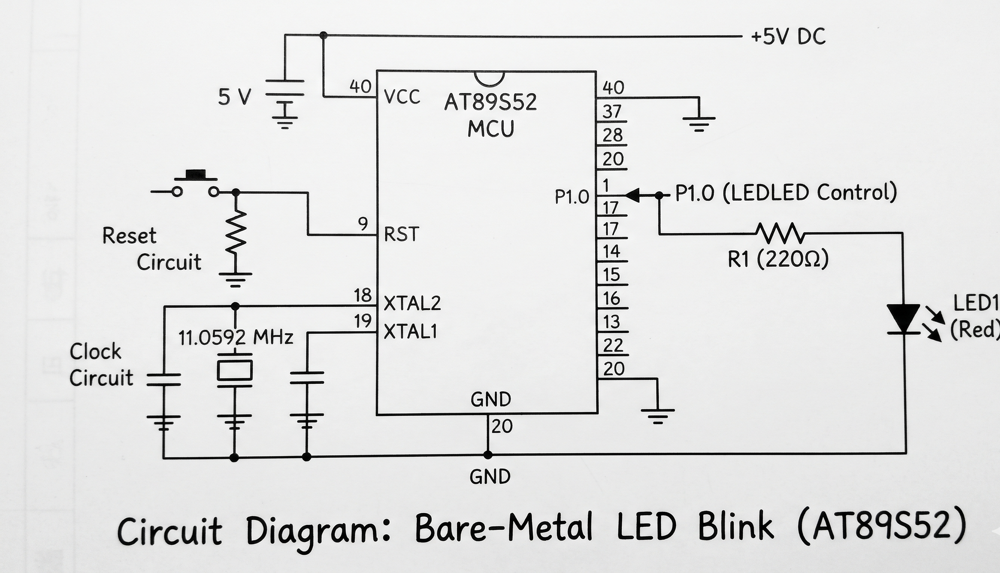

# CAT2 – TASK2B: 8051 Toolchain Setup and LED Blinking

## Experiment Details
- **Microcontroller:** AT89S52 (8051 family)
- **Clock:** 11.0592 MHz crystal
- **Development environment:** Keil µVision with the C51 compiler
- **Output:** LED connected to P1.0 through a current-limiting resistor
- **Source file:** `cat2_led_blink.c`

## Objective
Set up a basic 8051 Embedded C project and control a GPIO pin to make an LED blink continuously.

## Circuit Diagram

## Working Principle
P1.0 is configured as the LED control output. The program repeatedly drives the pin low and high, with a software delay between each transition. The source assumes an active-low LED connection: writing 0 turns the LED on, while writing 1 turns it off.

## Implementation
- `sbit LED = P1^0` gives the LED pin a readable name.
- `delay_ms()` uses nested loops to create an approximate delay.
- The infinite loop alternates the LED state, holding each state for approximately 500 ms.
- The delay is software-based and depends on the clock frequency and compiler-generated instructions; it is not a precision timer.

## Output and Observation
The LED connected to P1.0 repeatedly turns on and off, with an approximately half-second interval for each state.

## Inference
This experiment demonstrates basic GPIO output control, bit-addressable pin definitions, software delay generation, and the structure of a simple Embedded C program for the 8051.