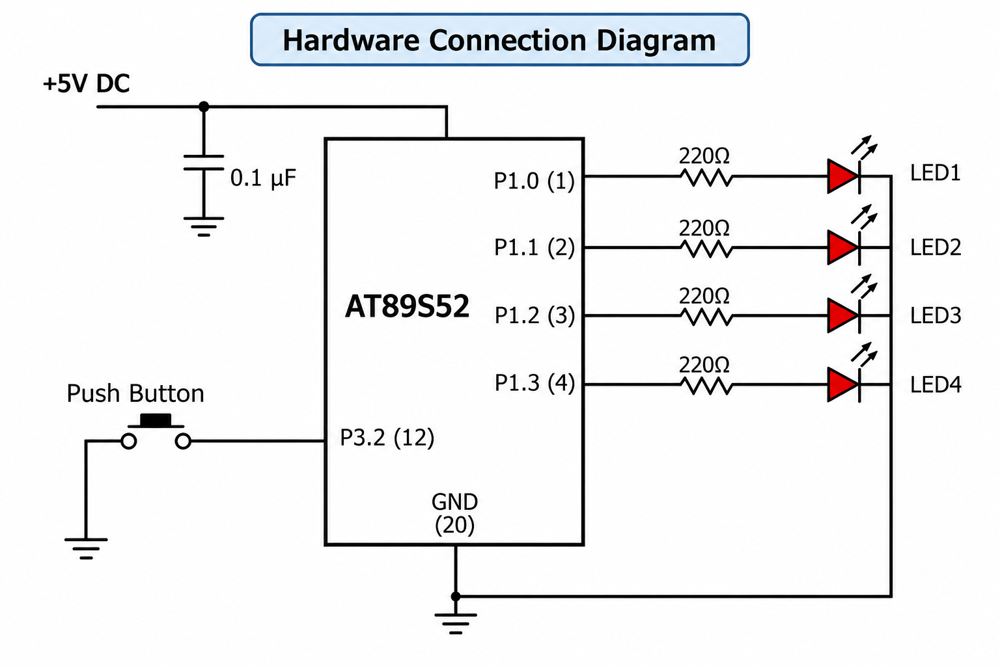

# CAT3 – TASK3A: LED Operating Modes and Pattern Control

## Experiment Details
- **Microcontroller:** AT89S52
- **Clock:** 11.0592 MHz crystal
- **LED connections:** P1.0–P1.3
- **Mode-selection input:** Push button on P3.2 (active low)
- **Source file:** `led_modes.c`

## Objective
Control four LEDs using a push button to select and run different LED patterns.

## Circuit Diagram

## Working Principle
The program uses a variable named `mode` to keep track of the selected operating mode. Each valid button press advances to the next mode. The button is polled continuously, and a short delay is used to debounce the input. The program also waits for the button to be released so that one press produces one mode change.

The four LEDs are controlled through the lower four bits of Port 1.

## Implementation
The program implements the following states:

1. **Initial state:** All four LEDs are off.
2. **Running pattern:** One LED is switched on at a time in sequence from P1.0 to P1.3.
3. **Binary counter:** The four LEDs display binary values from 0000 to 1111.
4. **Alternating pattern:** The output alternates between 1010 and 0101.
5. **All-LED flash:** All four LEDs switch on and off together.

The pattern functions periodically check the button. If the mode changes while a pattern is running, the function returns so that the main loop can execute the newly selected mode.

## Output and Observation
Pressing the button cycles through the initial state and the four LED patterns. The selected pattern continues repeating until another button press changes the mode.

## Inference
This experiment demonstrates GPIO port control, button polling, software debouncing, state-based program flow, and the generation of LED patterns using Embedded C.