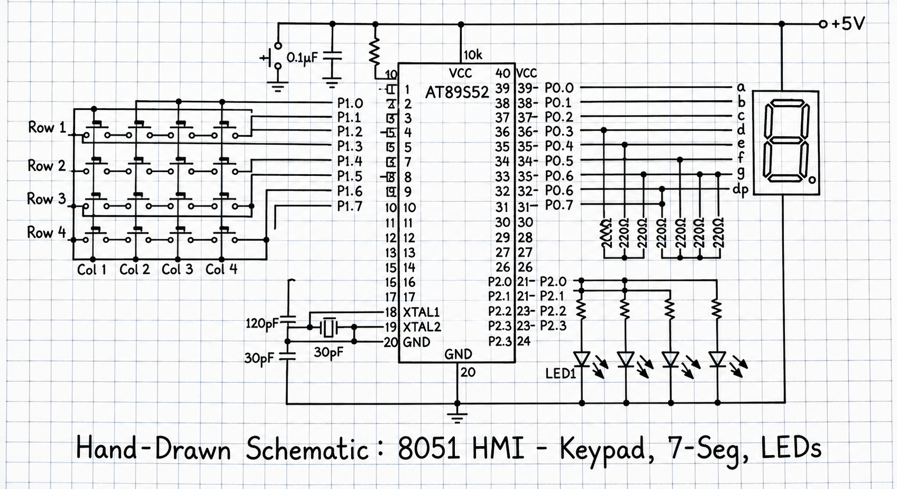

# CAT4 – TASK4A: Matrix Keypad, LED and Seven-Segment Interfacing

## Experiment Details
- **Microcontroller:** AT89S52
- **Clock:** 11.0592 MHz crystal
- **LED outputs:** P1.0–P1.3
- **Seven-segment data port:** Port 2
- **Keypad interface:** Port 3
- **Display type used by the code:** Common-cathode seven-segment display
- **Source file:** `matrix_7_seg.c`

## Objective
Interface a matrix keypad with the 8051 and use key presses to control LED patterns and display the corresponding digit on a seven-segment display.

## Circuit Diagram

## Working Principle
The program scans the keypad row by row by writing a row-select pattern to Port 3 and checking the resulting port value to identify a pressed key. The detected key is passed to two functions: one updates the seven-segment display, and the other selects the corresponding LED operation.

The seven-segment display is driven using a lookup table containing the segment codes for decimal digits 0–9. The code writes the selected pattern directly to Port 2.

## Implementation
- `seg_codes[]` stores the common-cathode segment patterns for digits 0–9.
- `keypad_scan()` checks the keypad rows and identifies the supported key values.
- `display_digit()` writes the matching digit pattern to Port 2.
- `led_control()` maps keys 1–4 to individual LEDs, 5 to a running pattern, 6 to an alternating pattern, 7 to a binary count, 8 to an all-LED flash, 9 to all LEDs off, and 0 to reset the LED output and display zero.
- A short delay is included after detecting a key press.

## Output and Observation
A detected numeric key is shown on the seven-segment display and triggers its mapped LED operation. The LED patterns are generated by writing values to the lower four bits of Port 1.

## Inference
This experiment combines matrix keypad scanning, lookup-table-based seven-segment output, and GPIO control of multiple LEDs in a single 8051 application.