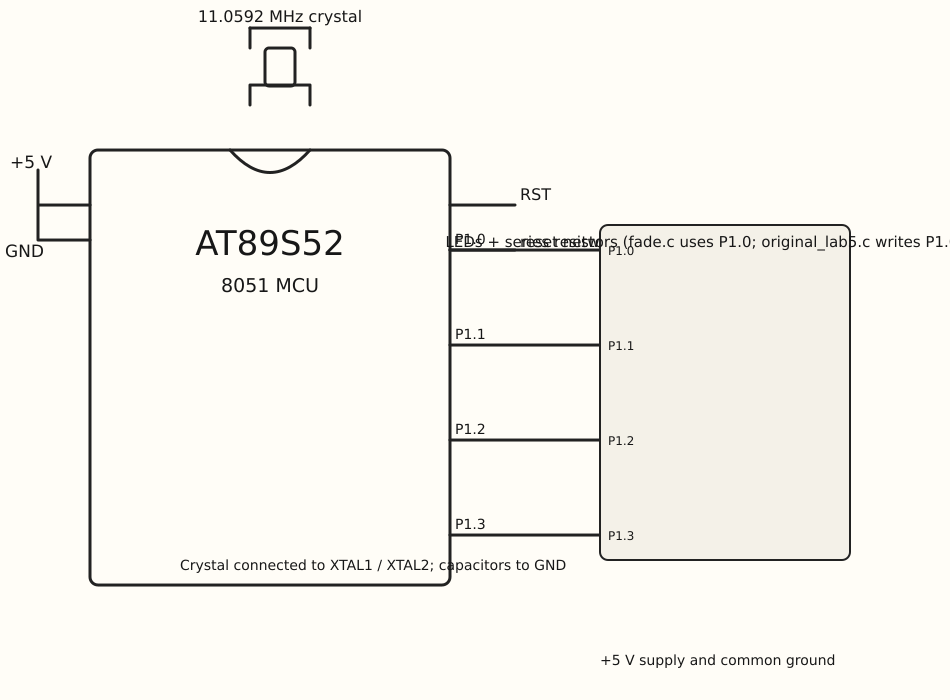

# CAT5 – TASK5A: LED Fading Using Software PWM

## Experiment Details
- **Microcontroller:** AT89S52
- **Clock:** 11.0592 MHz crystal
- **Timer:** Timer 0, Mode 1
- **Output:** LED control on P1.0
- **Source file:** `fade.c`

## Objective
Vary the average power delivered to an LED by generating a pulse-width-modulated digital output under Timer 0 interrupt control.

## Circuit Diagram

## Working Principle
The Timer 0 interrupt periodically updates a software counter. The program divides the timing sequence into a repeating set of ten ticks and compares the current tick with a duty-related value. This determines whether P1.0 is driven high or low during each part of the cycle.

A separate counter updates the duty variable at a slower rate. The variable increases until it reaches its upper limit, then decreases until it reaches zero. This repeated increase and decrease changes the output duty cycle and creates the fading effect.

## Implementation
- Timer 0 is configured in Mode 1 using `TMOD = 0x01`.
- The timer is reloaded with `TH0 = 0xFC` and `TL0 = 0x66` inside the ISR.
- `ET0` and `EA` enable the Timer 0 interrupt and global interrupts; `TR0` starts the timer.
- The `tick`, `ms`, `duty`, and `up` variables control the PWM timing and the direction in which the duty value changes.
- The main function remains in an infinite loop while the interrupt routine handles the output.

## Output and Observation
The program continuously changes the duty-related threshold, producing a PWM-style output on P1.0 whose average level rises and falls over time. With an LED connected to this output, the intended result is a gradual increase and decrease in apparent brightness.

## Inference
This task demonstrates timer interrupt programming, software generation of PWM-style signals, and control of LED brightness by varying the duty cycle.