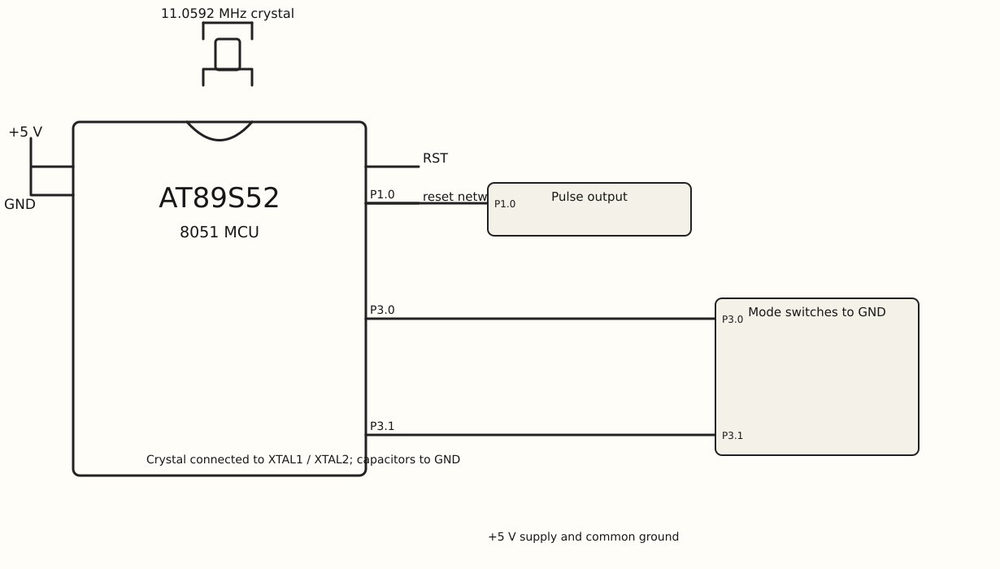

# CAT5 – TASK5B: Variable-Frequency Square-Wave Generation

## Experiment Details
- **Microcontroller:** AT89S52
- **Clock:** 11.0592 MHz crystal
- **Timer:** Timer 0, Mode 1
- **Waveform output:** P1.0
- **Mode-selection inputs:** P3.0 and P3.1 (active low)
- **Source file:** `square_wave.c`

## Objective
Generate a square wave on P1.0 and change its frequency using two digital mode-selection inputs.

## Circuit Diagram

## Working Principle
Timer 0 generates periodic interrupts. In the main loop, the program checks P3.0 and P3.1 and selects a tick limit. The interrupt routine increments a counter on every timer interrupt. When the counter reaches the selected limit, P1.0 is toggled and the counter is reset.

The selected limit controls the time between output transitions. Since a complete square-wave period contains one high interval and one low interval, the output frequency depends on twice the toggle interval.

## Implementation
- Timer 0 is configured in Mode 1 and reloaded with `TH0 = 0xFC` and `TL0 = 0x66`.
- `ET0`, `EA`, and `TR0` enable and start timer interrupts.
- If P3.0 is low, `limit` is set to 10.
- Otherwise, if P3.1 is low, `limit` is set to 2.
- If neither input is low, `limit` is set to 50.
- P3.0 is checked first, so it takes priority if both inputs are low.
- The ISR toggles P1.0 whenever `ticks` reaches `limit`.

## Output and Observation
A square-wave signal is generated on P1.0. Changing the input state changes the number of timer interrupts between successive transitions, thereby changing the waveform frequency. The source does not display or measure the frequency.

## Inference
This task demonstrates the use of a hardware timer interrupt to generate a digital waveform and the use of GPIO inputs to select its timing.