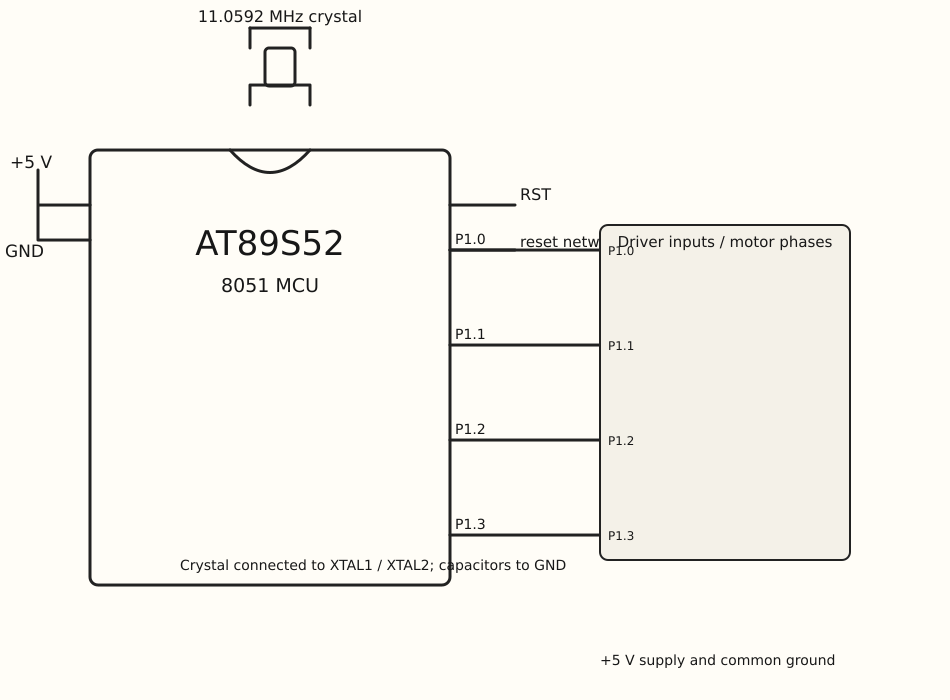

# CAT5 – TASK5C: Stepper-Motor Phase Sequencing

## Experiment Details
- **Microcontroller:** AT89S52
- **Clock:** 11.0592 MHz crystal
- **Timer:** Timer 0, Mode 1
- **Output port:** Port 1
- **Phase sequence:** 0x08, 0x04, 0x02, 0x01
- **Source file:** `stepper.c`

## Objective
Generate a repeating sequence of digital output patterns on Port 1 to drive the phases of a stepper-motor interface at a timer-controlled rate.

## Circuit Diagram

## Working Principle
Timer 0 periodically invokes an interrupt service routine. The ISR increments a tick counter and, when the counter reaches 50, resets it and writes the next value from the phase sequence to Port 1. The sequence index advances modulo four, so the four output patterns repeat continuously.

## Implementation
- Timer 0 is configured in Mode 1 and reloaded with `TH0 = 0xFC` and `TL0 = 0x66`.
- `ET0`, `EA`, and `TR0` enable and start the timer interrupt.
- The `seq[]` array stores the four output patterns: `0x08`, `0x04`, `0x02`, and `0x01`.
- After every 50 timer interrupts, the ISR writes the next pattern to P1 and advances `step` using modulo-four indexing.
- The source continuously repeats this sequence. It does not contain a separate direction-control input.

## Output and Observation
The four output patterns are applied to Port 1 in sequence, one phase line at a time. The interval between updates is controlled by the Timer 0 interrupt counter.

## Inference
This task demonstrates periodic output sequencing using a timer interrupt. The generated phase sequence can be used with a suitable stepper-motor driver interface.