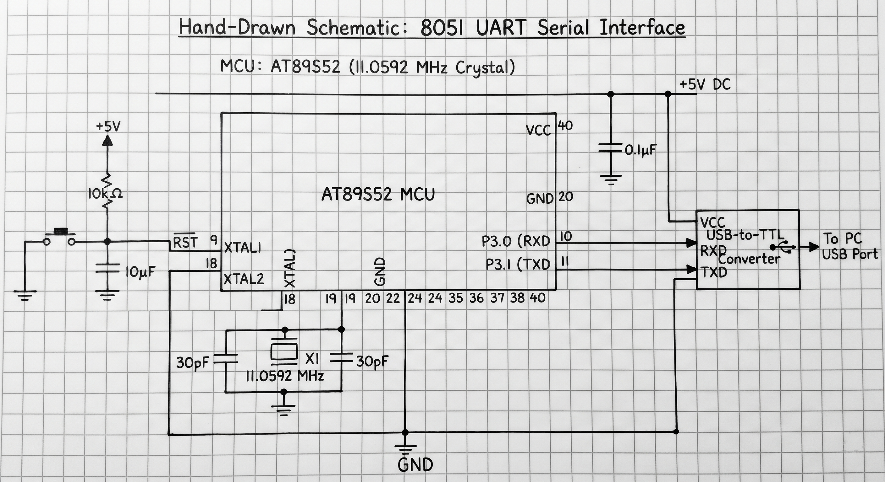

# CAT6 – TASK6A: UART Initialization and Serial Transmission

## Experiment Details
- **Microcontroller:** AT89S52
- **Clock:** 11.0592 MHz crystal
- **Communication:** On-chip UART, Mode 1
- **Baud rate:** 9600 baud
- **Timer configuration:** Timer 1, Mode 2
- **Source file:** `task_A.c`

## Objective
Initialize serial communication on the 8051 and transmit a text message repeatedly through the UART.

## Circuit Diagram

## Working Principle
Timer 1 is configured in 8-bit auto-reload mode and loaded with 0xFD. With the 11.0592 MHz crystal, this setting is used by the program to generate a 9600-baud UART rate. The serial control register SCON is set to 0x50, selecting UART Mode 1 and enabling reception.

To transmit a character, the program writes it to SBUF and waits for the transmit flag TI to become set. It then clears TI before sending the next character. The string function repeats this process until the null terminator is reached.

## Implementation
- `UART_Init()` configures Timer 1, starts it, and sets the UART mode.
- `UART_SendChar()` writes one character to SBUF and waits for transmission to complete.
- `UART_SendString()` sends each character in a null-terminated string.
- The main loop sends `Hello from 8051` followed by a carriage return and line feed, then waits approximately one second before repeating.

## Output and Observation
A serial terminal configured for 9600 baud, 8 data bits, no parity, and 1 stop bit receives the message `Hello from 8051` approximately once per second.

## Inference
This experiment demonstrates UART configuration, baud-rate generation using Timer 1, and polling-based serial transmission using SBUF and TI.