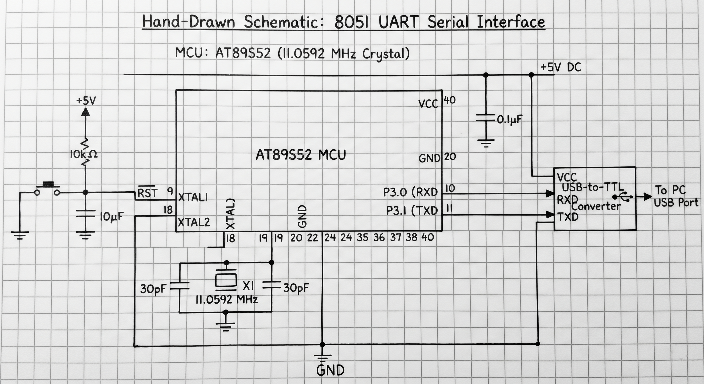

# CAT6 – TASK6B: UART Character Reception and Echo

## Experiment Details
- **Microcontroller:** AT89S52
- **Clock:** 11.0592 MHz crystal
- **Communication:** On-chip UART, Mode 1
- **Baud rate:** 9600 baud
- **Timer configuration:** Timer 1, Mode 2
- **Source file:** `task_B.c`

## Objective
Receive a character from a serial terminal and transmit the same character back through the 8051 UART.

## Circuit Diagram

## Working Principle
The UART is configured in Mode 1, with Timer 1 operating in 8-bit auto-reload mode to generate the baud rate. The receiver is enabled through the REN bit in SCON.

The program polls the receive flag RI. When a character arrives, RI becomes set. The receive function clears RI and reads the received character from SBUF. The main loop then passes that character to the transmit function, which writes it back to SBUF and waits for TI to indicate completion.

## Implementation
- `UART_Init()` configures Timer 1 and enables UART reception.
- `UART_ReceiveChar()` waits until RI is set, clears the flag, and returns the received character from SBUF.
- `UART_SendChar()` transmits the received character and clears TI after transmission.
- The main loop continuously receives one character and echoes it back.

## Output and Observation
When a character is entered in a serial terminal configured for 9600 baud, 8 data bits, no parity, and 1 stop bit, the 8051 sends the same character back to the terminal.

## Inference
This experiment demonstrates polling-based UART reception and transmission, including the use of RI, TI, and SBUF for serial data handling.