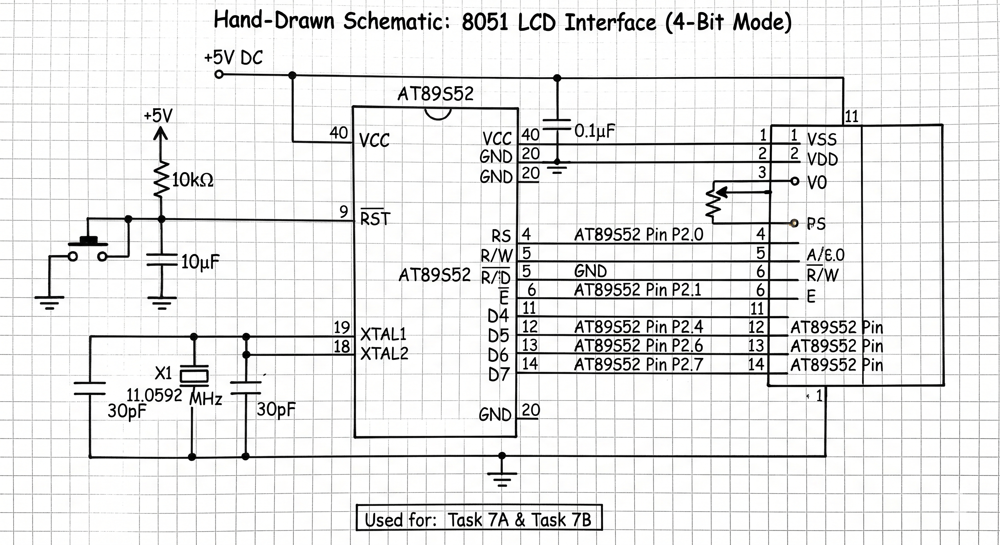

# CAT7 – TASK7A: LCD Initialization and Text Display

## Experiment Details
- **Microcontroller:** AT89S52
- **Clock:** 11.0592 MHz crystal
- **Display:** HD44780-compatible 16×2 character LCD
- **Interface:** 4-bit mode
- **Pin mapping:** RS – P2.0, EN – P2.1, D4–D7 – P2.4–P2.7
- **Source file:** `task7A_lcd.c`

## Objective
Initialize a 16×2 character LCD in 4-bit mode and display text on both rows using the 8051.

## Circuit Diagram

## Working Principle
The LCD receives commands and character data through the same four data lines. The RS pin selects whether the value is an instruction or display data, while EN is pulsed to latch each nibble.

Since the interface uses four data lines, each 8-bit command or character is sent in two parts: the higher nibble followed by the lower nibble. The initialization sequence configures a two-line display, selects the 5×8 character font, enables the display without the cursor, and sets the cursor to increment after each character.

## Implementation
- `lcd_cmd()` sends an instruction with RS low.
- `lcd_data()` sends a character with RS high.
- Both functions transfer the higher and lower nibbles and pulse EN after each nibble.
- `lcd_init()` performs the LCD initialization sequence.
- `lcd_puts()` sends a null-terminated string character by character.
- The main function displays `Hello SNU Chennai` on the first row and `IoT Lab CAT-7A` on the second row.

## Output and Observation
The LCD displays the two strings on separate rows and remains in that state.

## Inference
This experiment demonstrates LCD initialization, command/data selection, 4-bit data transfer, and text output using an 8051 microcontroller.