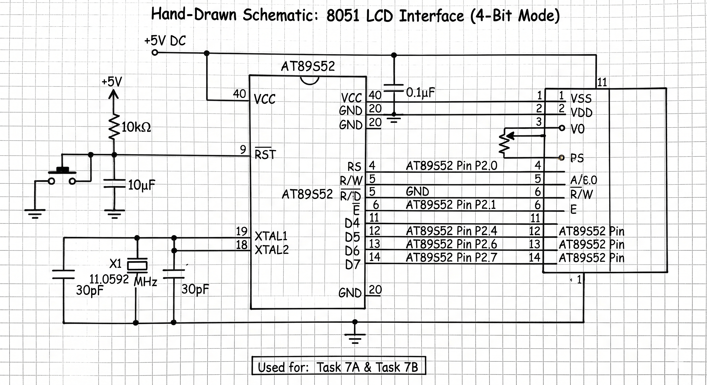

# CAT7 – TASK7B: LCD Cursor Positioning and Dynamic Counter Display

## Experiment Details
- **Microcontroller:** AT89S52
- **Clock:** 11.0592 MHz crystal
- **Display:** HD44780-compatible 16×2 character LCD
- **Interface:** 4-bit mode
- **Pin mapping:** RS – P2.0, EN – P2.1, D4–D7 – P2.4–P2.7
- **Source file:** `task7B_lcd.c`

## Objective
Extend the LCD interface with cursor positioning and integer-to-character output to display a continuously increasing counter.

## Circuit Diagram

## Working Principle
The LCD is initialized in 4-bit mode. The `lcd_goto()` function selects a display row and column by forming the corresponding DDRAM address: 0x80 plus the column for row 1, or 0xC0 plus the column for row 2.

The counter value is converted into decimal digits and sent to the LCD as character data. The program updates the second row approximately every 500 ms.

## Implementation
- `lcd_cmd()` and `lcd_data()` send commands and character data in two nibbles.
- `lcd_goto(row, col)` positions the cursor using the row's base DDRAM address and the column offset.
- `lcd_puts()` displays a string.
- `lcd_print_number()` extracts decimal digits using division and remainder, stores them in a buffer, and outputs them in the correct order.
- The main loop displays the label `Dynamic Value:` on row 1 and updates `Count:` followed by the counter value on row 2.

## Output and Observation
The first row displays a fixed label. The second row displays a counter that increments and is refreshed at half-second intervals.

## Inference
This experiment demonstrates LCD cursor addressing, integer-to-ASCII conversion, and periodic updating of displayed data.