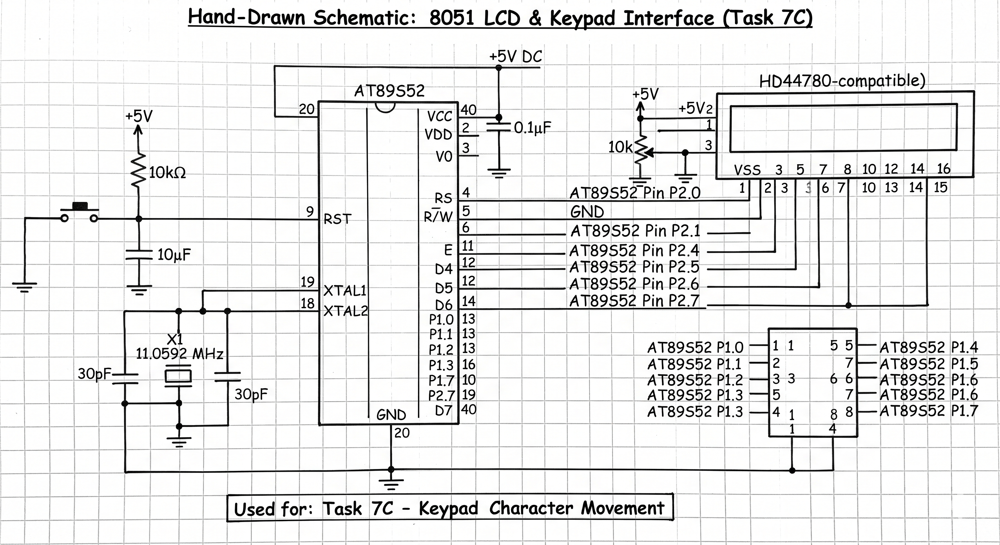

# CAT7 – TASK7C: Keypad-Controlled Character Positioning on an LCD

## Experiment Details
- **Microcontroller:** AT89S52
- **Clock:** 11.0592 MHz crystal
- **Display:** HD44780-compatible 16×2 character LCD
- **LCD interface:** 4-bit mode; RS – P2.0, EN – P2.1, D4–D7 – P2.4–P2.7
- **Keypad port assignment in source comments:** P1.0–P1.3 for rows and P1.4–P1.7 for columns
- **Source file:** `task7C_keypad_lcd.c`

## Objective
Develop an application that combines a matrix keypad and a 16×2 LCD so that directional key inputs can control the position of a character on the display.

## Circuit Diagram

## Working Principle
The application maintains a row and column position for a character on the LCD. The intended key mapping is 2 for up, 8 for down, 4 for left, and 6 for right. The row is constrained to the two LCD rows, and the column is constrained to the 16 available character positions.

The LCD is initialized in 4-bit mode. The program clears the display, positions the cursor using the current row and column, and writes the character `X`.

## Implementation
- The LCD command, data, initialization, and cursor-positioning routines use the same 4-bit interface as the earlier CAT7 tasks.
- The variables `r` and `c` store the character's row and column.
- The main loop checks the returned key value and updates the position within the LCD boundaries.
- In the current source file, `scan_keypad()` is a placeholder that returns 0; the row-and-column scanning logic has not yet been implemented. Therefore, the directional movement is not functional until that routine is completed.

## Output and Observation
The current program initializes the LCD and repeatedly displays `X` at the initial position (row 1, column 0). Since the keypad scanning function currently returns 0, key presses do not change the character position.

## Inference
This task contains the LCD positioning logic and the intended keypad navigation mapping. Completing `scan_keypad()` is required for the full keypad-controlled movement behavior.