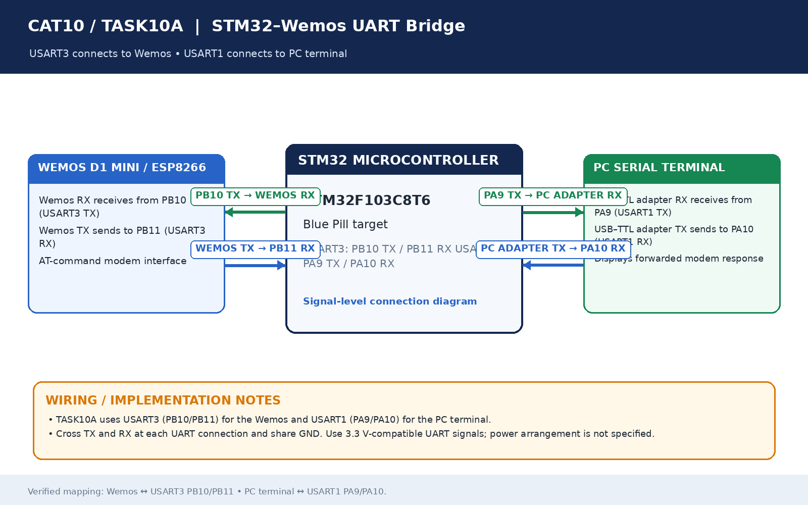

# CAT10 – TASK10A: Establish STM32 to Wemos D1 Mini UART Communication

## 1. Experiment Details
- **Experiment:** Establish STM32 and Wemos D1 Mini UART Communication
- **Task:** TASK10A
- **Microcontroller:** STM32F103C8T6
- **Development Environment:** STM32CubeMX and Keil µVision 5
- **Communication Module:** Wemos D1 Mini (ESP8266)
- **Modem UART:** USART3
- **Modem TX Pin:** PB10
- **Modem RX Pin:** PB11
- **PC Debug UART:** USART1
- **Debug TX Pin:** PA9
- **Debug RX Pin:** PA10
- **UART Configuration:** 115200 baud, 8 data bits, no parity, 1 stop bit (8-N-1)

## 2. Objective
To establish serial communication between the STM32 microcontroller and a Wemos D1 Mini using UART, transmit AT commands to the ESP8266 and observe its responses through a PC serial terminal.

## 3. Circuit Diagram

## 4. Working Principle
The STM32 communicates with the Wemos D1 Mini through USART3 using AT commands.

The program sends the command `AT\r\n` to the ESP8266 to check whether the module is responding.

- USART3 transmits the AT command to the Wemos D1 Mini.
- The ESP8266 processes the command and sends its response through UART.
- The STM32 receives the response with a timeout of up to 2000 ms.
- The received response is forwarded to the PC serial terminal through USART1.

This allows communication between the STM32 and ESP8266 to be monitored using a terminal application.

## 5. Implementation / Important Code Logic
- USART3 is configured for communication with the Wemos D1 Mini.
- USART1 is used for communication with the PC serial terminal.
- `HAL_UART_Transmit()` sends the AT command through USART3.
- `HAL_UART_Receive()` receives the ESP8266 response with a 2000 ms timeout.
- The received response is forwarded through USART1 using `HAL_UART_Transmit()`.
- The communication uses the 115200 baud rate and 8-N-1 configuration.

## 6. Output and Observations
- The STM32 transmits the `AT` command to the Wemos D1 Mini.
- The ESP8266 processes the command and returns a response.
- The STM32 forwards the received response to the PC serial terminal.
- Successful communication can be observed through the ESP8266 response displayed in the terminal.

## 7. Inference
The experiment demonstrates UART-based communication between an STM32 microcontroller and an ESP8266 module. It establishes how AT commands can be transmitted, responses received and serial communication monitored through a PC terminal.