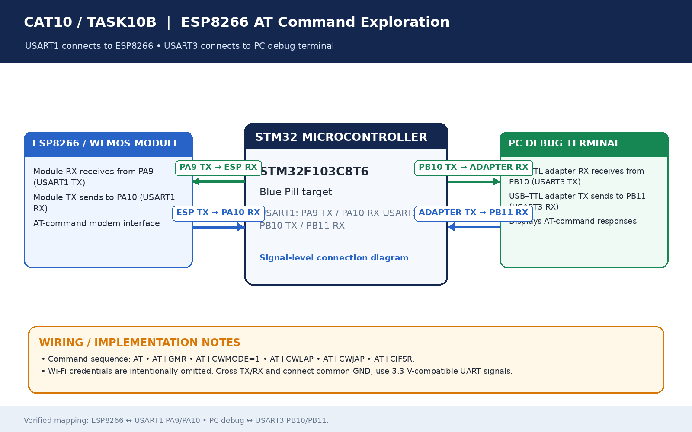

# CAT10 – TASK10B: Exploration of ESP8266 AT Command Interface

## 1. Experiment Details
- **Experiment:** Exploration of ESP8266 AT Command Interface
- **Task:** TASK10B
- **Microcontroller:** STM32F103C8T6
- **Development Environment:** STM32CubeMX and Keil µVision 5
- **Communication Module:** Wemos D1 Mini (ESP8266)
- **Modem UART:** USART1
- **Modem TX Pin:** PA9
- **Modem RX Pin:** PA10
- **PC Debug UART:** USART3
- **Debug TX Pin:** PB10
- **Debug RX Pin:** PB11
- **UART Configuration:** 115200 baud, 8 data bits, no parity, 1 stop bit (8-N-1)

## 2. Objective
To explore the ESP8266 AT command interface using an STM32 microcontroller, execute different AT commands and observe the responses through a PC serial terminal.

## 3. Circuit Diagram

## 4. Working Principle
The STM32 communicates with the ESP8266 module through USART1 by transmitting a sequence of AT commands.

The experiment explores different ESP8266 operations:

- `AT` – Checks communication with the ESP8266 module.
- `AT+GMR` – Retrieves firmware version information.
- `AT+CWMODE=1` – Configures the ESP8266 in Station mode.
- `AT+CWLAP` – Scans for available Wi-Fi networks.
- `AT+CWJAP` – Connects to a specified Wi-Fi access point.
- `AT+CIFSR` – Retrieves the network IP address information.

The ESP8266 responses are received through USART1 and forwarded to the PC serial terminal through USART3 for monitoring.

## 5. Implementation / Important Code Logic
- USART1 is configured for communication with the ESP8266.
- USART3 is used for PC terminal communication and debugging.
- The `cmds_10b()` function executes the AT command sequence.
- `HAL_UART_Transmit()` sends AT commands to the ESP8266 through USART1.
- `HAL_UART_Receive()` reads incoming response bytes.
- Received responses are forwarded through USART3 for terminal display.
- Wi-Fi connection parameters are configured locally and are not included in this documentation.

## 6. Output and Observations
- The ESP8266 responds to the basic `AT` command.
- Firmware information is retrieved using `AT+GMR`.
- Station mode is configured successfully using `AT+CWMODE=1`.
- Available Wi-Fi networks can be scanned using `AT+CWLAP`.
- The module can be instructed to connect to a Wi-Fi access point using `AT+CWJAP`.
- Network IP information can be queried using `AT+CIFSR`.
- The responses can be monitored through the PC serial terminal.

## 7. Inference
The experiment demonstrates the use of ESP8266 AT commands through UART communication with an STM32 microcontroller. It introduces Wi-Fi module configuration, network scanning, access point connection and IP address retrieval.