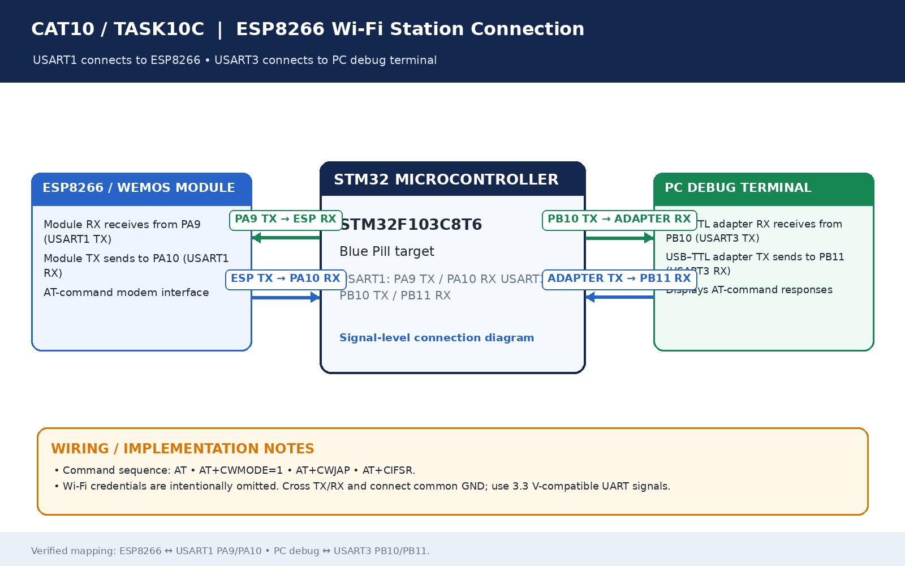

# CAT10 – TASK10C: Wi-Fi Station Connection and Network Verification

## 1. Experiment Details
- **Experiment:** Wi-Fi Station Connection and Network Verification
- **Task:** TASK10C
- **Microcontroller:** STM32F103C8T6
- **Development Environment:** STM32CubeMX and Keil µVision 5
- **Communication Module:** Wemos D1 Mini (ESP8266)
- **Modem UART:** USART1
- **Modem TX Pin:** PA9
- **Modem RX Pin:** PA10
- **PC Debug UART:** USART3
- **Debug TX Pin:** PB10
- **Debug RX Pin:** PB11
- **UART Configuration:** 115200 baud, 8 data bits, no parity, 1 stop bit (8-N-1)

## 2. Objective
To configure the ESP8266 Wi-Fi module in Station mode, establish a connection with a wireless access point and verify network connectivity using AT commands.

## 3. Circuit Diagram

## 4. Working Principle
The STM32 communicates with the ESP8266 through USART1 and executes a sequence of AT commands to establish a Wi-Fi connection.

The process involves:

1. Sending the `AT` command to verify communication with the ESP8266.
2. Sending `AT+CWMODE=1` to configure Station mode.
3. Sending `AT+CWJAP` with the locally configured Wi-Fi access point details to establish a connection.
4. Sending `AT+CIFSR` to retrieve the assigned IP address information.
5. Displaying the connection and network verification information through the PC serial terminal using USART3.

This allows the STM32 to configure the ESP8266 and verify its network connection.

## 5. Implementation / Important Code Logic
- USART1 handles communication with the ESP8266.
- USART3 is used for PC terminal output and debugging.
- The function `cmds_9c_wifi_connect()` executes the Wi-Fi connection and verification sequence.
- `AT+CWMODE=1` configures the ESP8266 in Station mode.
- `AT+CWJAP` requests connection to the configured wireless access point.
- The Wi-Fi connection command uses a 12000 ms timeout.
- `AT+CIFSR` retrieves IP address information.
- Connection status and verification information are printed through USART3.
- Wi-Fi credentials are configured locally and are not included in this documentation.

## 6. Output and Observations
- The ESP8266 responds to the initial AT command.
- Station mode is configured.
- The module attempts to connect to the specified Wi-Fi access point.
- IP address information is requested using `AT+CIFSR`.
- Connection and network verification information is displayed in the PC serial terminal.

## 7. Inference
The experiment demonstrates how an ESP8266 module can be configured as a Wi-Fi station using AT commands. It establishes the process of connecting to a wireless access point and retrieving network information through UART communication with an STM32 microcontroller.