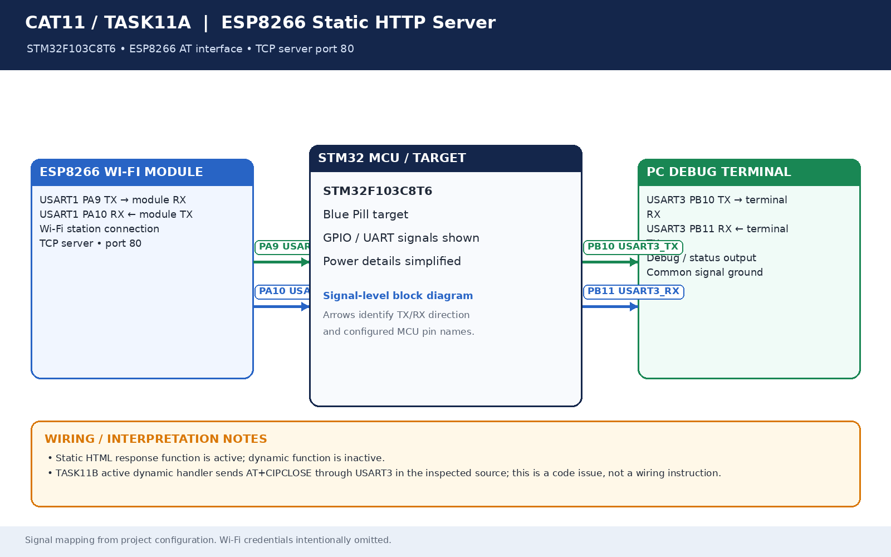

# CAT11 – TASK11A: ESP8266 TCP Server Configuration and Static HTTP Webpage

## 1. Experiment Details
- **Experiment:** ESP8266 TCP Server Configuration and Static HTTP Webpage
- **Task:** TASK11A
- **Microcontroller:** STM32F103C8T6
- **Development Environment:** STM32CubeMX and Keil µVision 5
- **Communication Module:** Wemos D1 Mini (ESP8266)
- **Modem UART:** USART1
- **Modem TX Pin:** PA9
- **Modem RX Pin:** PA10
- **PC Debug UART:** USART3
- **Debug TX Pin:** PB10
- **Debug RX Pin:** PB11
- **Server Port:** 80

## 2. Objective
To configure the ESP8266 as a TCP server using AT commands and serve a static HTML webpage to clients through an HTTP connection.

## 3. Circuit Diagram

## 4. Working Principle
The STM32 communicates with the ESP8266 through USART1 and configures it to operate as a TCP server.

The server configuration involves:
- Setting the ESP8266 to Station mode using `AT+CWMODE=1`.
- Configuring multiple connections using `AT+CIPMUX=1`.
- Starting the TCP server on port 80 using `AT+CIPSERVER=1,80`.

When a client sends an HTTP request, the ESP8266 reports the incoming connection through a `+IPD` notification.

The STM32 processes the received data, extracts the connection ID and sends a predefined static HTML webpage using the `AT+CIPSEND` command. After transmitting the webpage, the connection is closed using `AT+CIPCLOSE`.

## 5. Implementation / Important Code Logic
- USART1 handles AT command communication with the ESP8266.
- USART3 is used for PC terminal output and debugging.
- `wifi_connection()` configures the ESP8266 and starts the TCP server.
- `http_server_connection_static()` monitors incoming `+IPD` data and extracts the connection ID.
- `snprintf()` prepares the connection-specific AT commands.
- `AT+CIPSEND` specifies the amount of data to be transmitted.
- The predefined HTML content is transmitted to the connected client.
- `AT+CIPCLOSE` closes the client connection through USART1.

The active implementation uses `http_server_connection_static()`. The dynamic server function is present but commented out.

## 6. Output and Observations
- The ESP8266 is configured as a TCP server on port 80.
- Incoming client requests are detected through `+IPD` notifications.
- The STM32 sends a predefined HTML webpage to the connected client.
- The connection is closed after the response is transmitted.

## 7. Inference
The experiment demonstrates TCP server configuration and basic HTTP webpage delivery using an ESP8266 module controlled by an STM32 microcontroller. It establishes how incoming client requests can be processed and answered with predefined HTML content.