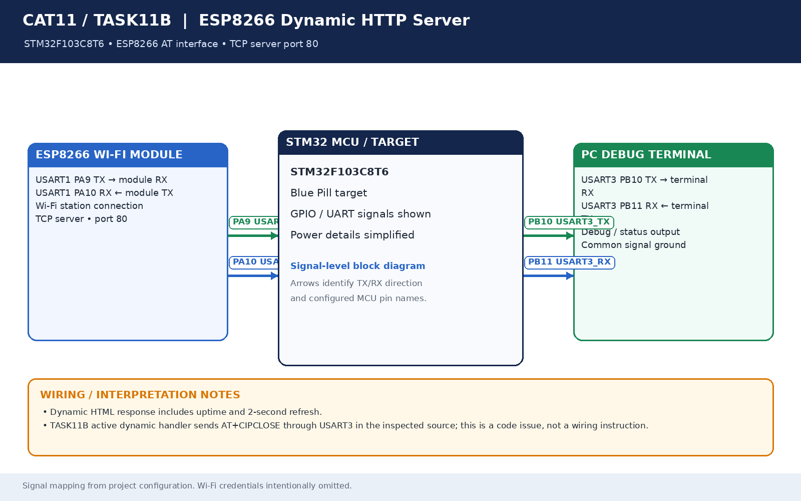

# CAT11 – TASK11B: Dynamic Telemetry HTTP Web Server

## 1. Experiment Details
- **Experiment:** Dynamic Telemetry HTTP Web Server
- **Task:** TASK11B
- **Microcontroller:** STM32F103C8T6
- **Development Environment:** STM32CubeMX and Keil µVision 5
- **Communication Module:** Wemos D1 Mini (ESP8266)
- **Modem UART:** USART1
- **Modem TX Pin:** PA9
- **Modem RX Pin:** PA10
- **PC Debug UART:** USART3
- **Debug TX Pin:** PB10
- **Debug RX Pin:** PB11
- **Server Port:** 80

## 2. Objective
To implement a dynamic HTTP web server using an STM32 microcontroller and ESP8266 module, generating webpage content based on system uptime and periodically refreshing the displayed information.

## 3. Circuit Diagram

## 4. Working Principle
The STM32 configures the ESP8266 as a TCP server on port 80 using AT commands.

When a client sends an HTTP request, the ESP8266 reports the incoming data through a `+IPD` notification.

The active dynamic server function processes the request and generates HTML content containing the current system uptime.

- System uptime is calculated using `HAL_GetTick() / 1000`.
- The generated webpage displays the uptime in seconds.
- An HTML meta-refresh setting automatically refreshes the webpage every 2 seconds.
- The generated HTML response is transmitted to the client through the ESP8266 using `AT+CIPSEND`.

The webpage therefore displays dynamically generated information rather than a predefined static page.

## 5. Implementation / Important Code Logic
- USART1 handles communication with the ESP8266.
- USART3 is used for PC terminal output and debugging.
- `wifi_connection()` configures the ESP8266 as a TCP server.
- `http_server_connection_dynamic()` processes incoming client requests and generates dynamic HTML content.
- `HAL_GetTick()` provides the system tick count used to calculate uptime.
- `snprintf()` formats the uptime value and constructs the HTML response.
- The HTML meta-refresh directive is configured for a 2-second refresh interval.
- `AT+CIPSEND` transmits the generated webpage to the connected client.

**Implementation Observation:** In the active dynamic server function, the `AT+CIPCLOSE` command is transmitted through `huart3` instead of `huart1`. Since `huart1` is connected to the ESP8266, this is an incorrect UART assignment in the connection-close operation. The source code has not been modified.

## 6. Output and Observations
- The ESP8266 is configured as a TCP server on port 80.
- Incoming HTTP client requests are processed by the dynamic server function.
- The generated webpage displays the system uptime in seconds.
- The webpage is configured to refresh automatically every 2 seconds.
- The connection-close command has an incorrect UART assignment in the active implementation.

## 7. Inference
The experiment demonstrates dynamic webpage generation using an STM32 microcontroller and ESP8266-based TCP server. It shows how system runtime information can be incorporated into HTTP responses and displayed through a browser with automatic page refreshing.