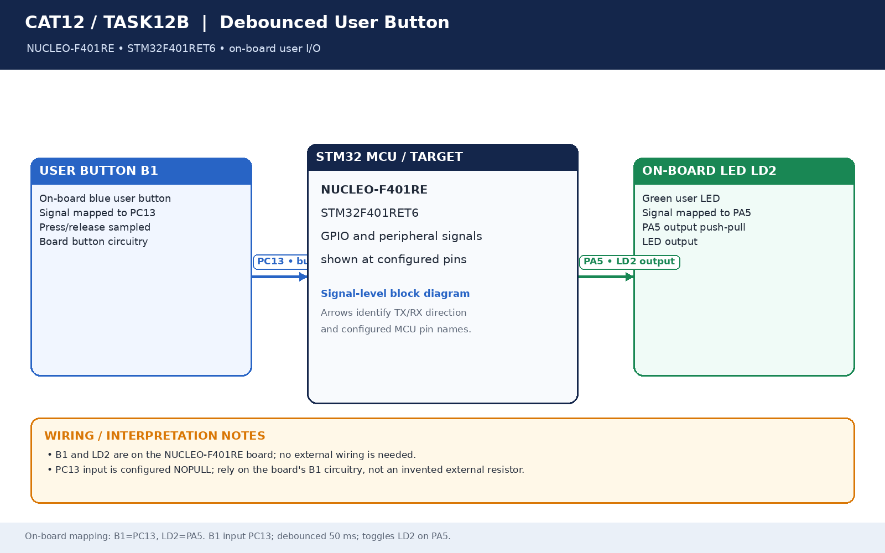

# CAT12 – TASK12B: Debounced User Button B1 Toggling LED LD2 with State Memory

## 1. Experiment Details
- **Experiment:** Debounced User Button B1 Toggling LED LD2 with State Memory
- **Task:** TASK12B
- **Microcontroller:** STM32F401RET6
- **Development Board:** NUCLEO-F401RE
- **Development Environment:** STM32CubeMX and Keil µVision 5
- **GPIO Input:** PC13 (User Button B1)
- **GPIO Output:** PA5 (On-board Green LED LD2)

## 2. Objective
To interface the user push button with the STM32 microcontroller and implement software debouncing to toggle the on-board LED reliably with each valid button press.

## 3. Circuit Diagram

## 4. Working Principle
The user button B1 is connected to PC13 and operates as an active-low input.

The program continuously monitors the button state.

1. When PC13 reads `GPIO_PIN_RESET`, a button press is detected.
2. A 50 ms delay is introduced to debounce the input.
3. The button state is checked again to confirm the press.
4. If the press is confirmed, the LED on PA5 is toggled.
5. The program waits until the button is released before processing another press.

This prevents multiple LED toggles caused by mechanical switch bouncing.

## 5. Implementation / Important Code Logic
- PC13 is configured as a GPIO input with `GPIO_NOPULL`.
- PA5 is configured as a push-pull GPIO output.
- `HAL_GPIO_ReadPin()` detects the button state.
- `HAL_Delay(50)` provides the software debounce interval.
- The button state is checked again after the delay.
- `HAL_GPIO_TogglePin()` changes the LED state.
- A release-detection loop waits until PC13 returns to its released state.

## 6. Output and Observations
- Pressing the user button toggles the on-board LED.
- Each confirmed press changes the LED state once.
- The LED retains its state until another valid button press.
- The 50 ms debounce delay helps prevent unintended repeated toggling.

## 7. Inference
The experiment demonstrates GPIO-based button interfacing and software debouncing using the STM32F401RE. It shows how input validation and state retention can provide reliable button-controlled LED operation.