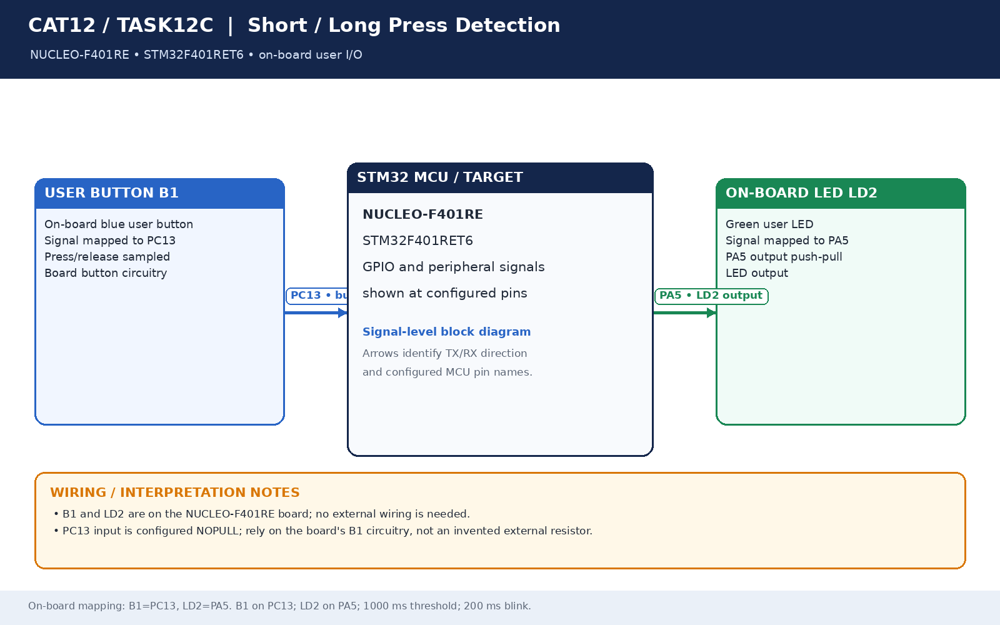

# Short Press and Long Press Detection Using SysTick

## 1. Experiment Details

- **Category:** CAT12 – STM32 GPIO and Timing
- **Task:** TASK12C
- **Microcontroller:** STM32F401RET6
- **Development Board:** NUCLEO-F401RE
- **Input:** User Button B1 (PC13)
- **Output:** On-board Green LED LD2 (PA5)
- **Development Environment:** STM32CubeMX and Keil µVision

## 2. Objective

To implement short-press and long-press detection using the STM32 SysTick timebase. A short press toggles the LED state, while a long press activates continuous LED blinking.

## 3. Circuit Diagram

## 4. Working Principle

The user button B1 connected to PC13 is used as the input, and the on-board LED LD2 connected to PA5 is used as the output.

The program uses `HAL_GetTick()` to measure the duration for which the button is held.

- **Short press:** If the button is released before 1000 ms, the LED state is toggled when blinking mode is inactive.
- **Long press:** If the button is held for at least 1000 ms, blinking mode is activated.
- **Blinking mode:** The LED blinks continuously at 200 ms intervals without using a blocking delay.
- **Stopping blinking:** A subsequent short press stops blinking mode and turns the LED OFF.

## 5. Implementation / Important Code Logic

1. **GPIO Configuration:** PC13 is configured as the button input, and PA5 is configured as the LED output.
2. **Button Detection:** The program detects a button press and records its starting time using `HAL_GetTick()`.
3. **Press Duration:** The elapsed time is calculated to distinguish between short and long presses.
4. **Short-Press Handling:** A press shorter than 1000 ms toggles the LED when blinking mode is inactive. If blinking is active, a short press disables it and switches the LED OFF.
5. **Long-Press Handling:** A press lasting at least 1000 ms enables blinking mode.
6. **Non-Blocking Blinking:** The elapsed time is checked against a 200 ms interval to toggle the LED without blocking the main program.

## 6. Output and Observations

- A short button press toggles the LED state.
- Holding the button for at least one second activates continuous LED blinking.
- While blinking, a short press stops the blinking and turns the LED OFF.
- LED blinking is controlled using elapsed-time checks rather than a blocking delay.

## 7. Inference

The experiment demonstrates how the STM32 SysTick timebase can be used to measure button press duration and implement different actions for short and long presses. It also demonstrates non-blocking LED control using elapsed-time comparisons.