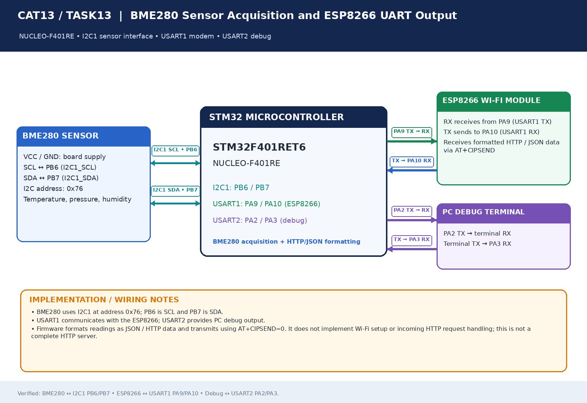

# BME280 Sensor Interfacing Using I2C

## 1. Experiment Details

- **Category:** CAT13 – Sensor Interfacing and Communication
- **Task:** TASK13
- **Microcontroller:** STM32F401RET6
- **Development Board:** NUCLEO-F401RE
- **Sensor:** BME280 Environmental Sensor
- **Communication:** I2C and UART
- **Development Environment:** STM32CubeMX and Keil µVision

## 2. Objective

To interface the BME280 environmental sensor with the STM32 microcontroller using I2C, acquire temperature, pressure, and humidity readings, and process the sensor data for serial output and transmission through an ESP8266 module.

## 3. Circuit Diagram

## 4. Working Principle

The BME280 sensor communicates with the STM32 microcontroller through the I2C1 peripheral.

The sensor is configured with its primary I2C address set to `0x76`. The program initializes the sensor using the Bosch BME280 Sensor API and configures oversampling and filtering parameters.

After initialization, the STM32 reads the environmental measurements from the sensor. The acquired temperature, pressure, and humidity values are displayed through the UART debug interface.

The program also formats the sensor readings into JSON data and constructs an HTTP response. This response is transmitted through the ESP8266 communication interface using UART.

## 5. Implementation / Important Code Logic

1. **I2C Configuration:** I2C1 is configured using PB6 as SCL and PB7 as SDA, operating at 100 kHz.
2. **UART Configuration:** USART1 (PA9/PA10) is used for ESP8266 communication, while USART2 (PA2/PA3) is used for debugging through the serial interface.
3. **Sensor Initialization:** The Bosch BME280 Sensor API is used to initialize the sensor with I2C address `0x76`.
4. **Measurement Configuration:** Temperature, pressure, and humidity oversampling are configured to 1x, with the filter disabled and normal operating mode selected.
5. **Sensor Data Acquisition:** The program periodically reads the environmental measurements from the BME280.
6. **Serial Output:** The acquired sensor readings are formatted and transmitted through USART2 for debugging and observation.
7. **JSON and HTTP Formatting:** Sensor readings are formatted into JSON data and included in an HTTP response.
8. **ESP8266 UART Transmission:** The program uses USART1 to send the formatted response through the ESP8266 interface using the `AT+CIPSEND` command.

## 6. Output and Observations

- The BME280 sensor is initialized through the I2C interface.
- Temperature, pressure, and humidity measurements are acquired from the sensor.
- Sensor readings are displayed through the UART debug interface.
- The program prepares JSON-formatted environmental data and an HTTP response.
- The formatted response is transmitted through the ESP8266 UART interface at periodic intervals.

**Implementation Note:** The current code does not include Wi-Fi initialization or handling of incoming HTTP requests. It transmits the prepared response using connection ID 0, assuming an existing connection. Therefore, this implementation demonstrates sensor acquisition and HTTP/JSON response transmission logic, rather than a complete independently operating HTTP server.

## 7. Inference

The experiment demonstrates I2C-based interfacing of the BME280 environmental sensor with an STM32 microcontroller. It also demonstrates sensor data processing, UART debugging, JSON formatting, and transmission of an HTTP-formatted response through an ESP8266 module.