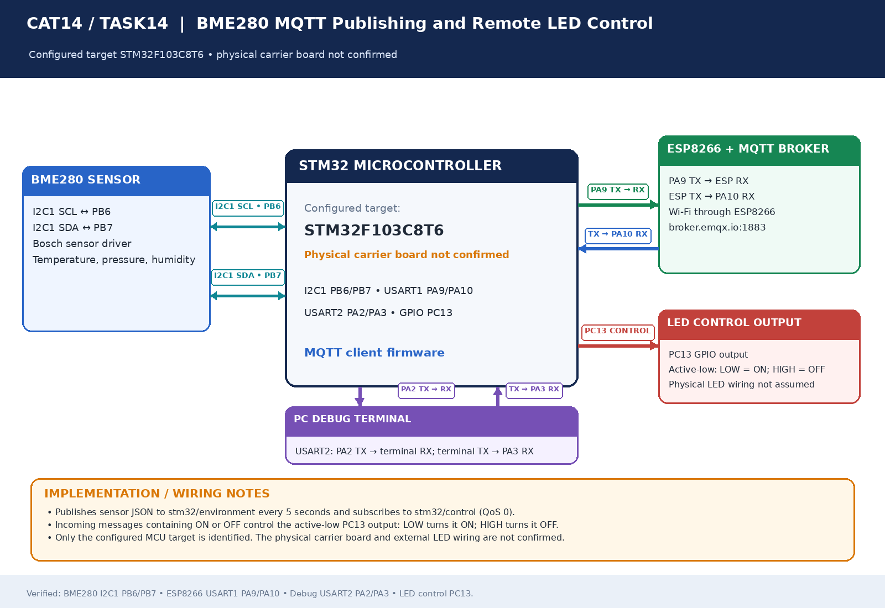

# BME280 Sensor Data Transmission Using MQTT

## 1. Experiment Details

- **Category:** CAT14 – MQTT-Based IoT Communication
- **Task:** TASK14
- **Configured Microcontroller:** STM32F103C8T6
- **Sensor:** BME280 Environmental Sensor
- **Communication Protocols:** I2C, UART and MQTT
- **ESP8266 Module:** Wi-Fi connectivity and MQTT communication
- **MQTT Broker:** broker.emqx.io
- **Development Environment:** STM32CubeMX and Keil µVision

## 2. Objective

To interface the BME280 environmental sensor with the STM32 microcontroller, acquire temperature, pressure, and humidity readings, and publish the sensor data to an MQTT broker through an ESP8266 module. The experiment also demonstrates receiving MQTT messages to control an onboard LED.

## 3. Circuit Diagram

## 4. Working Principle

The BME280 sensor communicates with the STM32 microcontroller through the I2C1 interface. The microcontroller reads temperature, pressure, and humidity measurements using the Bosch BME280 Sensor API.

The ESP8266 module is connected to the STM32 through USART1 and provides Wi-Fi connectivity. The custom ESP library (`ESPLib`) is used to initialize the ESP8266, establish a Wi-Fi connection, and communicate with the MQTT broker.

The STM32 connects to the public MQTT broker `broker.emqx.io` using port `1883`.

The program performs two main operations:

- **Publishing:** Environmental sensor readings are formatted as JSON and published to the MQTT topic `stm32/environment` every 5 seconds.
- **Subscribing:** The device subscribes to `stm32/control` and processes incoming messages to control the onboard LED connected to PC13. An `ON` message switches the LED ON, while an `OFF` message switches it OFF.

## 5. Implementation / Important Code Logic

1. **I2C Configuration:** I2C1 is configured using PB6 as SCL and PB7 as SDA for communication with the BME280 sensor.
2. **UART Configuration:** USART1 (PA9/PA10) is used for ESP8266 communication, while USART2 (PA2/PA3) is used for debugging.
3. **Sensor Initialization:** The Bosch BME280 driver is used to initialize the sensor and acquire environmental measurements.
4. **ESP8266 Initialization:** The custom `ESPLib` library initializes the ESP8266 using USART1.
5. **Wi-Fi Connection:** The ESP8266 connects to the configured Wi-Fi network.
6. **MQTT Connection:** The device establishes a TCP connection to `broker.emqx.io` on port `1883` and performs the MQTT connection procedure.
7. **MQTT Subscription:** The device subscribes to the `stm32/control` topic to receive control messages.
8. **Sensor Data Publishing:** Temperature, pressure, and humidity readings are formatted into JSON and published to `stm32/environment` every 5000 ms (5 seconds), using QoS 0.
9. **LED Control:** Incoming MQTT messages are processed by `MQTTDataHandler()`. The handler checks for the strings `ON` and `OFF` and controls the active-low LED on PC13 accordingly.

## 6. Output and Observations

- The BME280 sensor provides temperature, pressure, and humidity measurements.
- The ESP8266 establishes Wi-Fi connectivity and connects to the MQTT broker.
- Environmental readings are published as JSON messages to `stm32/environment` at 5-second intervals.
- The device subscribes to `stm32/control` and receives MQTT control messages.
- Receiving an `ON` message switches the PC13 LED ON, while receiving an `OFF` message switches it OFF.

## 7. Inference

The experiment demonstrates sensor interfacing using I2C, Wi-Fi communication through the ESP8266, and MQTT-based data exchange with a broker. It also demonstrates bidirectional IoT communication by publishing environmental sensor readings and receiving remote commands to control an LED.