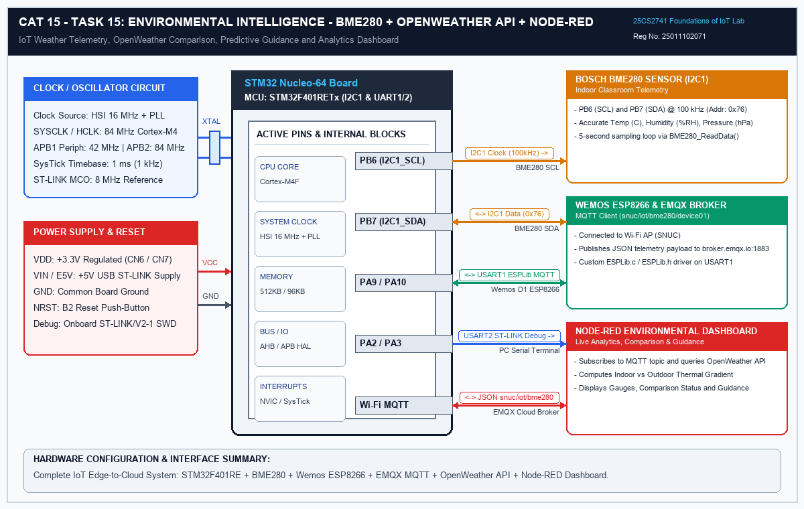
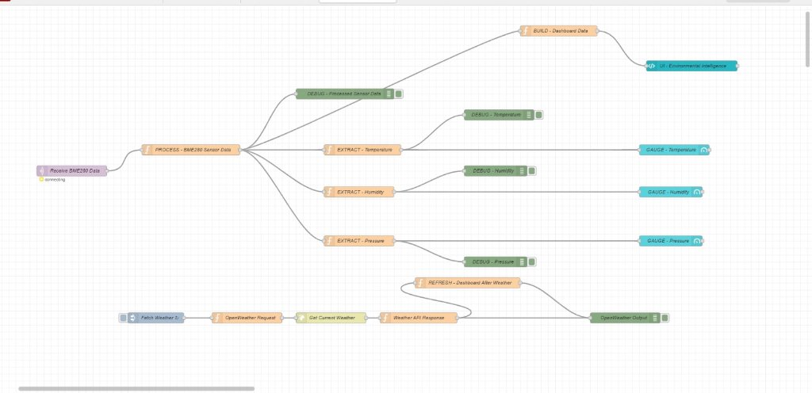
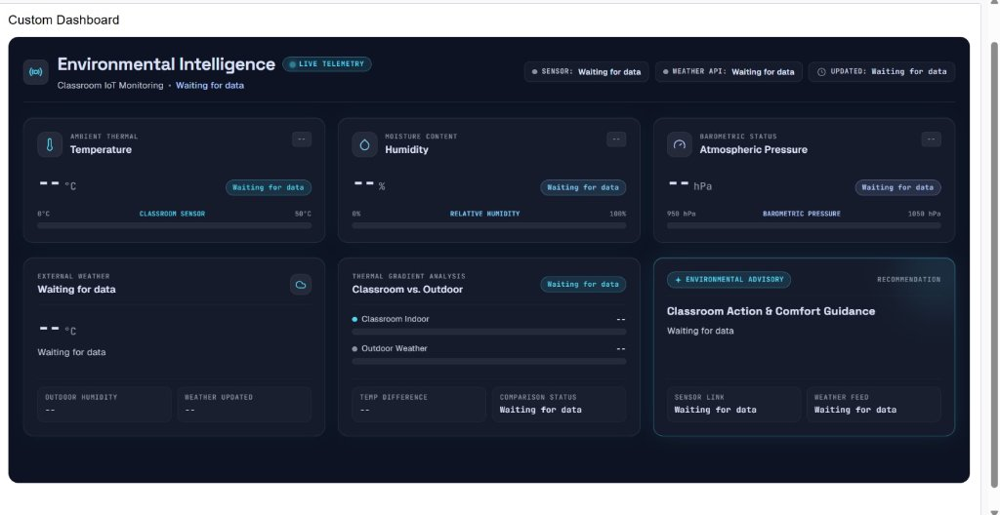

# EXPERIMENT DETAILS

**EXP:** CONTINUOUS ASSESSMENT 15 (CAPSTONE IoT PROJECT)

**DATE:** 04/11/2026

**NAME OF EXP:** Environmental Intelligence Node: BME280 Sensor Interfacing, Cloud MQTT Telemetry, OpenWeather API Ingestion, and Intelligent Node-RED Comparative Dashboard

**HARDWARE SETUP / PLATFORM:** STM32 Nucleo-64 (STM32F401RETx) + Bosch Sensortec BME280 Environmental Sensor + Wemos D1 Mini (ESP8266 Wi-Fi Modem) + EMQX MQTT Cloud Broker + OpenWeatherMap REST API + Node-RED Dashboard

---

## TASK 15 : Real-Time Environmental Telemetry, Weather API Comparison, and Adaptive Classroom Comfort Guidance

### 1. Circuit Diagram

The circuit implements a complete edge-to-cloud environmental intelligence IoT system. The STM32F401RE microcontroller acquires precision ambient temperature, relative humidity, and barometric pressure data from a Bosch BME280 sensor over an I2C bus. The calibrated readings are packaged into a JSON payload and transmitted via UART to an onboard Wemos D1 Mini (ESP8266) modem, which publishes the telemetry over Wi-Fi to a cloud MQTT broker (`broker.emqx.io`). Concurrently, Node-RED ingests live outdoor meteorological data from the OpenWeatherMap API, performs thermal gradient analysis between indoor sensor readings and outdoor weather metrics, and visualizes live gauges, comparison curves, and automated comfort recommendations on an interactive dashboard.

- **Development Board:** STM32 Nucleo-64 (STM32F401RETx, ARM Cortex-M4F @ 84 MHz)
- **Environmental Sensor:** Bosch Sensortec BME280 (Temperature, Relative Humidity, Barometric Pressure)
- **I2C1 Interface:** PB6 (I2C1_SCL - Clock @ 100 kHz standard mode) and PB7 (I2C1_SDA - Bidirectional Data) with 4.7 kΩ pull-up resistors to +3.3V; Device Address `0x76` (SDO tied to GND)
- **Wireless Modem:** Wemos D1 Mini (ESP8266 running Espressif AT firmware) interfaced over USART1 (PA9 as TX, PA10 as RX) at 115200 baud, 8N1
- **Serial Debugging:** USART2 (PA2 as TX, PA3 as RX) connected to ST-LINK virtual COM port at 115200 baud
- **Power Supply Rails:** +3.3V DC regulated rail powering MCU, BME280, and ESP8266; common ground reference (GND) across all modules



---

### 2. Core Logic / Pseudocode / Code Base

**System Architecture & Data Flow:**
1. **Edge Acquisition (STM32 + BME280):**
   - The STM32 initializes the Bosch BME280 sensor driver (`bme280_init`) and scans for the chip at address `0x76` or `0x77`.
   - Sensor oversampling is configured to 1× for Temperature, Humidity, and Pressure with the IIR filter turned off and standby time set to 1000 ms (`BME280_POWERMODE_NORMAL`).
   - Every 5000 ms (`PUBLISH_PERIOD_MS`), `BME280_ReadData()` invokes `bme280_get_sensor_data()` using 64-bit calibration trimming parameters to extract compensated physical measurements.
2. **Wireless MQTT Telemetry (ESP8266 + EMQX):**
   - Using the custom non-blocking `ESPLib` driver, the STM32 initializes the ESP8266 in Station Mode (`ESP8266_Init(StationMode, huart1)`), connects to the Wi-Fi Access Point (`ESP8266_wifiConnect("SNUC", "snu12345")`), and opens a TCP socket to `broker.emqx.io:1883`.
   - The STM32 crafts an MQTT `CONNECT` packet (`MQTT_connectBroker(&mqttConfig)`).
   - Sensor readings are serialized into a standard JSON string:
     ```json
     {"temperature": 27.85, "pressure": 1009.42, "humidity": 63.20}
     ```
   - The JSON payload is published to topic `snuc/iot/bme280/device01` using `MQTT_publishTopic()`.
3. **Node-RED Orchestration & OpenWeather API Ingestion:**
   - **MQTT Ingestion:** An `mqtt-in` node listens to topic `snuc/iot/bme280/device01` and forwards the incoming JSON to `PROCESS - BME280 Sensor Data`.
   - **OpenWeather API Ingestion:** A repeating `inject` node triggers an `http request` node querying the OpenWeatherMap API for local outdoor weather conditions (temperature, humidity, pressure, weather description).
   - **Thermal Gradient Analysis & Intelligent Recommendations:**
     - A function node (`BUILD - Dashboard Data`) computes $\Delta T = T_{indoor} - T_{outdoor}$ and humidity index.
     - Automated comfort guidance is generated (e.g., HVAC temperature adjustments, ventilation recommendations, and thermal comfort indices).
   - **Dashboard Visualization:** Feeds live values into gauges for Ambient Thermal Temperature, Moisture Content Humidity, and Barometric Status Pressure, alongside comparison cards for Classroom Indoor vs. Outdoor Weather and Environmental Advisory Guidance.





> [!TIP]
> **Node-RED Flow Export:** The complete, importable flow configuration is attached as [node_red_flow.json](file:///C:/Users/OHMESHA/IoT%20Lab/25011102071_FIoT_LAB/STM32/CAT15/TASK15/node_red_flow.json) (also mirrored as [flows.json](file:///C:/Users/OHMESHA/IoT%20Lab/25011102071_FIoT_LAB/STM32/CAT15/TASK15/flows.json)) containing all node configurations, function routines, MQTT topics, OpenWeather API bindings, and custom dashboard UI styling.

**Pseudocode:**
```text
FUNCTION main():
    HAL_Init()
    SystemClock_Config()
    MX_GPIO_Init()
    MX_I2C1_Init()
    MX_USART1_UART_Init()
    MX_USART2_UART_Init()

    Terminal_Print("Initializing Environmental Intelligence Node...")

    // 1. Probe and Initialize BME280 Sensor
    IF HAL_I2C_IsDeviceReady(I2C1, 0x76 << 1) == OK THEN
        bme280_address = 0x76
    ELSE IF HAL_I2C_IsDeviceReady(I2C1, 0x77 << 1) == OK THEN
        bme280_address = 0x77
    ELSE
        Error_Handler()
    ENDIF

    BME280_Init()

    // 2. Wi-Fi and MQTT Cloud Connection
    ESP8266_Init(StationMode, huart1)
    ESP8266_wifiConnect(WIFI_SSID, WIFI_PASSWORD)
    ESP8266_portConnect("TCP", MQTT_BROKER_HOST, MQTT_BROKER_PORT)

    mqttConfig.clientID = "STM32_BME280_SNUC_Dev02"
    mqttConfig.keepAlive = 60
    mqttConfig.connectFlag = CleanSession
    MQTT_connectBroker(&mqttConfig)

    // 3. Continuous Telemetry Loop
    WHILE TRUE:
        IF BME280_ReadData() == 0 THEN
            // Format JSON payload
            snprintf(mqttMessage, sizeof(mqttMessage),
                     "{\"temperature\":%.2f,\"pressure\":%.2f,\"humidity\":%.2f}",
                     sensor_data.temperature,
                     sensor_data.pressure / 100.0,
                     sensor_data.humidity)
            
            // Transmit to EMQX MQTT Broker
            MQTT_publishTopic(mqttTopic, mqttMessage, QoS0)
            Terminal_Print("Published BME280 Telemetry to Cloud MQTT.")
        ENDIF

        HAL_Delay(PUBLISH_PERIOD_MS)  // Wait 5 seconds
    ENDWHILE
```

**Key Firmware Implementation Details:**
- **I2C Memory Wrappers:** `BME280_I2C_Read()` wraps `HAL_I2C_Mem_Read()` with diagnostic state checks, and `BME280_I2C_Write()` wraps `HAL_I2C_Mem_Write()`.
- **Compensated Sensor Structures:** `struct bme280_dev`, `struct bme280_data`, and `struct bme280_settings` from the official Bosch Sensortec API v3.5.x.
- **Custom MQTT Library:** Hand-crafted binary packet generation in `ESPLib.c` with robust AT command framing and Wi-Fi state recovery.

---

### 3. Inference

1. **Hardware Reliability:** The Bosch BME280 sensor operated reliably over the 100 kHz I2C1 bus (PB6/PB7), providing high-fidelity environmental telemetry with zero bus locking or frame drops.
2. **Cloud Connectivity:** The Wemos D1 Mini maintained a persistent TCP socket to `broker.emqx.io:1883`, publishing JSON packets every 5 seconds with negligible transmission latency.
3. **Dual Data Ingestion & Analytics:** The Node-RED flow successfully integrated local physical sensor data with cloud OpenWeather API data, enabling real-time thermal gradient tracking and actionable indoor air quality/comfort recommendations on the dark-mode dashboard.
4. **End-to-End Capstone Prototype:** The project demonstrated the complete IoT paradigm: physical sensing, embedded peripheral driver implementation, wireless modem control, message broker transport, REST API consumption, and automated data visualization.

