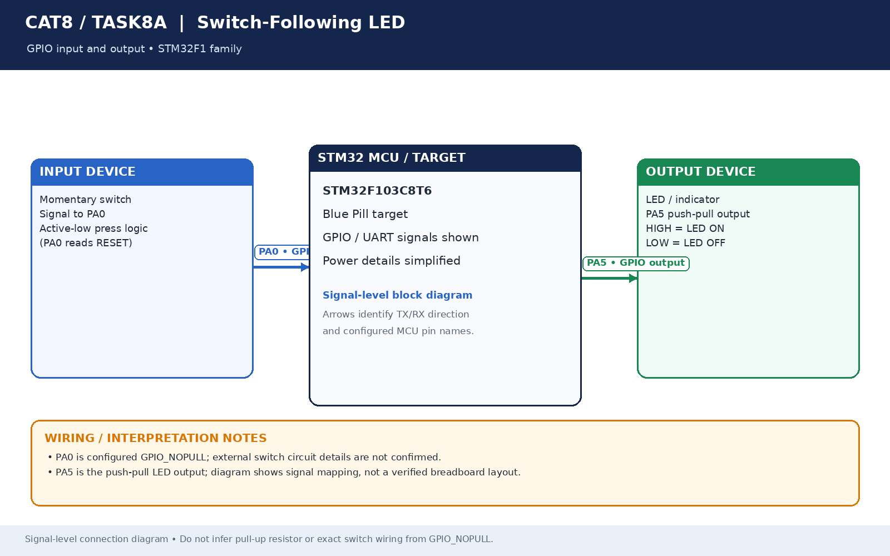

# CAT8 – TASK8A: GPIO Input/Output Configuration (Switch-Following LED)

## 1. Experiment Details
- **Experiment:** GPIO Input/Output Configuration
- **Task:** TASK8A
- **Microcontroller:** STM32F103C8T6
- **Development Environment:** STM32CubeMX and Keil µVision 5
- **GPIO Input:** PA0
- **GPIO Output:** PA5

## 2. Objective
To configure GPIO pins as digital input and output and control an LED based on the state of an external switch using the STM32 HAL library.

## 3. Circuit Diagram

## 4. Working Principle
The STM32 continuously monitors the state of the switch connected to PA0.

- When the switch is pressed, PA0 reads `GPIO_PIN_RESET`, and PA5 is driven HIGH to turn ON the LED.
- When the switch is released, PA0 reads `GPIO_PIN_SET`, and PA5 is driven LOW to turn OFF the LED.

The input pin is configured with `GPIO_NOPULL`, meaning that neither an internal pull-up nor an internal pull-down resistor is enabled.

## 5. Implementation / Important Code Logic
- PA0 is configured as a GPIO input.
- PA5 is configured as a push-pull GPIO output.
- `HAL_GPIO_ReadPin()` reads the switch state.
- `HAL_GPIO_WritePin()` controls the LED according to the input state.
- A 10 ms delay is used in the continuous polling loop.

## 6. Output and Observations
- Pressing the switch turns ON the LED.
- Releasing the switch turns OFF the LED.
- The LED follows the switch state through continuous GPIO polling.

## 7. Inference
The experiment demonstrates GPIO input and output configuration using the STM32 HAL library. It establishes how an external digital input can be read and used to control an output device.