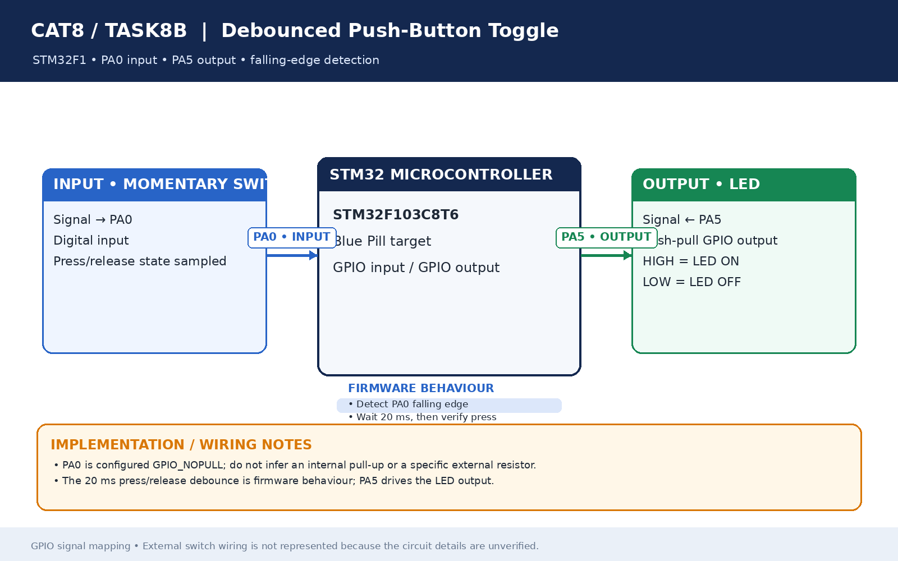

# CAT8 – TASK8B: Event-Based Switch Control with Software Debouncing

## 1. Experiment Details
- **Experiment:** Event-Based Switch Control with Software Debouncing
- **Task:** TASK8B
- **Microcontroller:** STM32F103C8T6
- **Development Environment:** STM32CubeMX and Keil µVision 5
- **GPIO Input:** PA0
- **GPIO Output:** PA5

## 2. Objective
To detect switch-press events using GPIO input polling and implement software debouncing to prevent multiple unintended LED toggles caused by mechanical switch bouncing.

## 3. Circuit Diagram

## 4. Working Principle
Mechanical switches may produce multiple rapid electrical transitions when pressed or released. This phenomenon is known as switch bouncing.

The program detects a switch press when PA0 reads `GPIO_PIN_RESET`.

1. A 20 ms delay is introduced after detecting a press.
2. The input is checked again to confirm the press.
3. If the press is confirmed, the LED state on PA5 is toggled.
4. The program waits until the switch is released.
5. An additional 20 ms delay is applied after release.

This approach helps prevent multiple toggles from a single switch press.

## 5. Implementation / Important Code Logic
- PA0 is configured as a GPIO input with `GPIO_NOPULL`.
- PA5 is configured as a push-pull GPIO output.
- `HAL_GPIO_ReadPin()` checks the switch state.
- `HAL_Delay(20)` provides the software debounce delay.
- `HAL_GPIO_TogglePin()` changes the LED state.
- A release-detection loop prevents another press event from being processed until the switch is released.

## 6. Output and Observations
- Each confirmed switch press toggles the LED state.
- The LED remains in its previous state until another valid press occurs.
- Software debouncing helps prevent multiple toggles from a single press.

## 7. Inference
The experiment demonstrates event-based switch handling using GPIO polling and software debouncing. It shows how timed input verification can reduce unintended operations caused by mechanical switch bouncing.