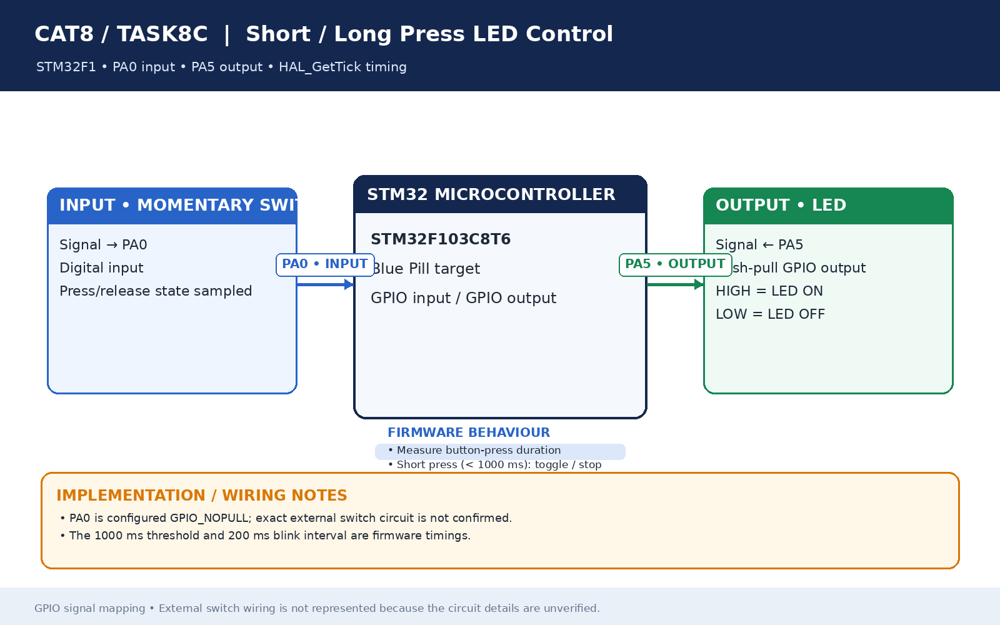

# CAT8 – TASK8C: Short Press vs Long Press Detection Using SysTick Timebase

## 1. Experiment Details
- **Experiment:** Short Press and Long Press Detection
- **Task:** TASK8C
- **Microcontroller:** STM32F103C8T6
- **Development Environment:** STM32CubeMX and Keil µVision 5
- **GPIO Input:** PA0
- **GPIO Output:** PA5
- **Timebase:** SysTick using `HAL_GetTick()`

## 2. Objective
To distinguish between short and long switch presses using the STM32 system tick timebase and implement LED control with non-blocking blinking functionality.

## 3. Circuit Diagram

## 4. Working Principle
The program monitors the switch connected to PA0 and measures the duration of each press using `HAL_GetTick()`.

Two types of press events are identified:

- **Short Press (< 1000 ms):**
  - If blinking mode is inactive, the LED on PA5 toggles once.
  - If blinking mode is active, a short press stops blinking and turns OFF the LED.

- **Long Press (≥ 1000 ms):**
  - Activates continuous LED blinking mode.

When blinking mode is active, the LED toggles every 200 ms without using a blocking delay for the blinking interval.

## 5. Implementation / Important Code Logic
- PA0 is configured as a GPIO input with `GPIO_NOPULL`.
- PA5 is configured as a push-pull GPIO output.
- `HAL_GetTick()` records the time when the switch is pressed and calculates the press duration.
- A 1000 ms threshold distinguishes short and long presses.
- A state variable tracks whether blinking mode is active.
- `HAL_GPIO_TogglePin()` changes the LED state.
- The blinking interval is controlled using `HAL_GetTick()` with a 200 ms interval, allowing non-blocking LED operation.

## 6. Output and Observations
- A short press toggles the LED when blinking mode is inactive.
- A long press activates continuous LED blinking.
- A short press while blinking mode is active stops blinking and turns OFF the LED.
- The LED blinks at 200 ms intervals in blinking mode.

## 7. Inference
The experiment demonstrates switch-press duration measurement using the SysTick timebase. It shows how short and long press events can be distinguished and how non-blocking timing can be used to control LED behaviour.