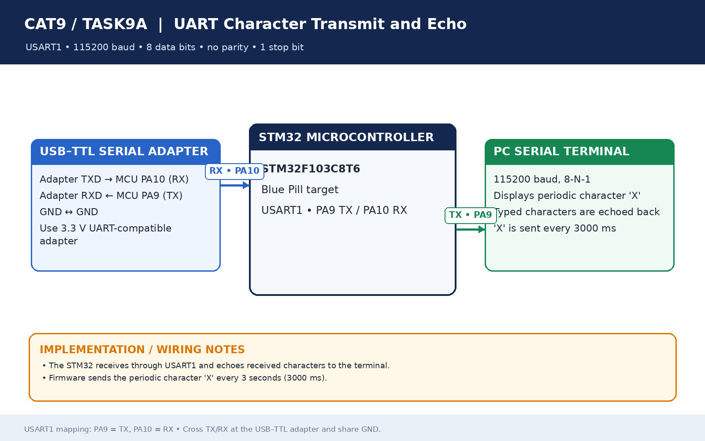

# CAT9 – TASK9A: Basic UART Character Transmission and Echo

## 1. Experiment Details
- **Experiment:** Basic UART Character Transmission and Echo
- **Task:** TASK9A
- **Microcontroller:** STM32F103C8T6
- **Development Environment:** STM32CubeMX and Keil µVision 5
- **Communication Peripheral:** USART1
- **TX Pin:** PA9
- **RX Pin:** PA10
- **UART Configuration:** 115200 baud, 8 data bits, no parity, 1 stop bit (8-N-1)

## 2. Objective
To establish serial communication between the STM32 microcontroller and a PC terminal using UART, implementing character reception, echo transmission and periodic character transmission.

## 3. Circuit Diagram

## 4. Working Principle
UART enables asynchronous serial communication between the STM32 microcontroller and an external terminal.

The program continuously checks for incoming characters through USART1.

- When a character is received, it is transmitted back to the terminal, producing an echo.
- Independently, the program periodically transmits the character `'X'` every 3000 ms (3 seconds).

The UART communication uses the configured 115200 baud rate with an 8-N-1 frame format.

## 5. Implementation / Important Code Logic
- USART1 is configured for asynchronous serial communication.
- PA9 is used for UART transmission (TX).
- PA10 is used for UART reception (RX).
- `HAL_UART_Receive()` polls for an incoming byte with a 10 ms timeout.
- `HAL_UART_Transmit()` sends the received byte back to the terminal.
- `HAL_GetTick()` tracks elapsed time for periodic transmission.
- The character `'X'` is transmitted every 3000 ms without relying on a blocking delay for the periodic timing.

## 6. Output and Observations
- Characters entered in the serial terminal are received by the STM32 and echoed back.
- The character `'X'` is transmitted automatically every 3 seconds.
- Serial communication operates at 115200 baud using the 8-N-1 configuration.

## 7. Inference
The experiment demonstrates basic UART communication using the STM32 HAL library. It establishes character reception, echo transmission and periodic data transmission through an asynchronous serial interface.