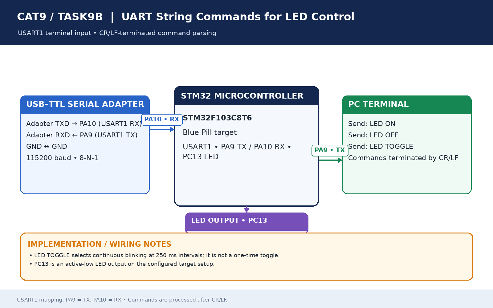

# CAT9 – TASK9B: String-Based UART Command-Controlled LED Interface

## 1. Experiment Details
- **Experiment:** String-Based UART Command-Controlled LED Interface
- **Task:** TASK9B
- **Microcontroller:** STM32F103C8T6
- **Development Environment:** STM32CubeMX and Keil µVision 5
- **Communication Peripheral:** USART1
- **TX Pin:** PA9
- **RX Pin:** PA10
- **UART Configuration:** 115200 baud, 8 data bits, no parity, 1 stop bit (8-N-1)
- **LED Output:** PC13 (Active-Low)

## 2. Objective
To implement a UART-based command interface that receives string commands from a serial terminal and controls an LED using GPIO output operations.

## 3. Circuit Diagram

## 4. Working Principle
The STM32 receives characters from a serial terminal through USART1 and stores them in a buffer until a carriage return (`\r`) or newline (`\n`) is detected.

The received command is then compared with predefined strings:

- **LED ON:** Drives PC13 LOW to turn ON the active-low LED.
- **LED OFF:** Drives PC13 HIGH to turn OFF the LED.
- **LED TOGGLE:** Activates continuous blinking mode, toggling the LED every 250 ms.

The active-low configuration means that a LOW output turns the LED ON, while a HIGH output turns it OFF.

## 5. Implementation / Important Code Logic
- USART1 is configured for asynchronous serial communication at 115200 baud.
- PA9 and PA10 are used for UART transmission and reception respectively.
- Incoming characters are collected in a command buffer.
- `strcmp()` compares the received command with the predefined commands.
- `HAL_GPIO_WritePin()` controls the LED for ON and OFF commands.
- A state variable tracks the LED operating mode.
- `HAL_GPIO_TogglePin()` is used to toggle the LED.
- `HAL_GetTick()` controls the continuous blinking interval of 250 ms without using a blocking delay for the blinking operation.

## 6. Output and Observations
The following commands can be entered through the serial terminal:

| UART Command | Observed Behaviour |
|---|---|
| `LED ON` | Turns ON the LED |
| `LED OFF` | Turns OFF the LED |
| `LED TOGGLE` | Starts continuous blinking at 250 ms intervals |

The STM32 processes the received string commands and controls the LED accordingly.

## 7. Inference
The experiment demonstrates UART-based command processing and GPIO control using the STM32 HAL library. It shows how serial terminal commands can be used to control an output device and implement different operating modes.